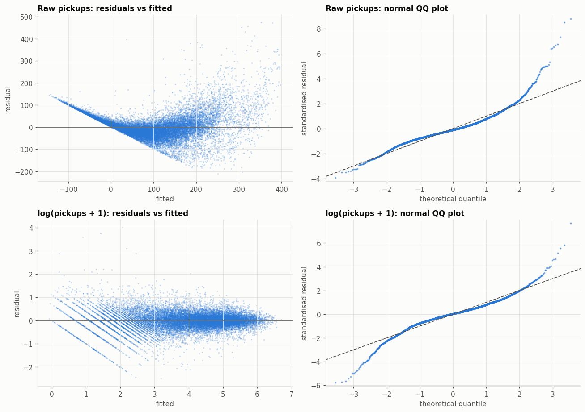
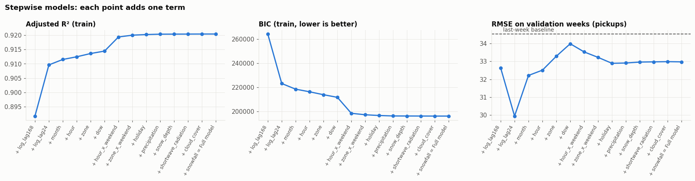
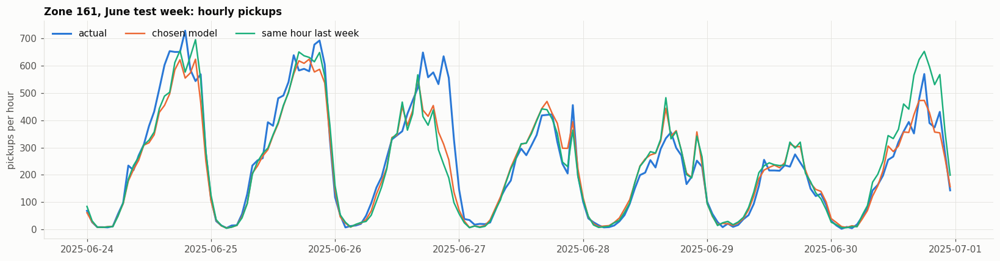

# Model Building and Selection

What `scripts/06_model_selection.ipynb` does, why each step is there, what it found and how problems were fixed. Every number comes from the notebook's run on the cleaned 2025 data.

To rerun: build the data with pipeline steps 1–4 (see `CLAUDE.md`), then run all cells of the notebook (about 3 minutes). The plots below are saved by the notebook to `docs/img/`, so rerunning it updates them.

---

## 1. Setup

### What is modelled

| Choice | Value | Why |
|---|---|---|
| What one row is | one zone in one hour | The dispatch decision is "how many taxis, where, at what hour". |
| Zones | the 50 busiest | They carry most of the pickups. Quiet zones are mostly hours with zero pickups, which a linear regression handles badly. |
| What is predicted | `log(pickups + 1)` | See Step 1. The `+ 1` is there because log(0) doesn't exist. |

### Train / validation / test

In **every month**, the last 7 days are **test**, the 7 days before are **validation** and the rest is **train**.

- **Train** (227,850 rows) is used to fit the models and run the tests.
- **Validation** (100,800 rows) is used to pick the best model.
- **Test** (100,750 rows) is used once, at the end, to check the chosen model on weeks it has never seen.

Why not simply train on Jan–Sep and test on Oct–Dec? The model has a separate effect for each month, and it can't learn October's effect if no October data is in training. Taking the test days from every month solves that.

### Predictors

| Predictor | What it is |
|---|---|
| hour, day of week, month, zone | when and where the pickup happens (each as a set of 0/1 columns) |
| holiday | 1 on a US federal holiday |
| weekend daily pattern | weekends have different busy hours from weekdays |
| zone weekend shift | some zones are busier on weekends, others quieter |
| temperature (and its square) | the square tests whether demand rises in both cold *and* heat |
| rain, new snow, snow on the ground, cloud cover, sunlight, daylight (`is_day`) | weather |
| yesterday's and last week's pickups | pickups in the same zone and clock hour 1 day and 7 days earlier |

**Why yesterday's and last week's pickups?** The proposal plans to use "historic pickup activity". Both values are known before the day starts, so a dispatcher could use them in a next-day plan.

### Why every test uses "standard errors clustered by day"

The weather is the same for all 50 zones in a given hour, and a rainy or busy day affects all of its hours. So the 227,850 rows aren't 227,850 independent observations of weather. They are closer to ~200 independent days. Normal regression tests assume every row is independent, which would make almost everything look significant.

Clustering by day tells the tests to treat rows from the same day as related, so the p-values are honest. It also fixes the uneven error spread found in Step 1.

---

## 2. Step 1: Checking the assumptions (residual plot, QQ plot)

### Why check

A regression's tests (p-values, F-tests) rely on two assumptions about the **errors** (actual demand minus predicted demand):
1. **The errors have the same spread at every demand level.** A quiet zone and a busy zone should be predicted about equally well. If the errors grow with demand, the tests are wrong.
2. **The errors are roughly normally distributed** (bell-shaped).

A demand model should also never predict a negative number of pickups.

All later steps rely on these tests, so this check comes first.

### What was done

The model with all predictors was fitted twice: once predicting raw `pickups`, once predicting `log(pickups + 1)`. For each, two plots:

| Plot | What it shows | Good looks like |
|---|---|---|
| Residuals vs fitted | whether the errors get bigger or smaller with the predicted demand | an even band around 0 |
| Normal QQ plot | whether the errors are normally distributed | points on the dashed line |

**Reading the QQ plot:** both axes are measured in standard deviations from the average, not percentages, so negative values are expected. Points bending away from the line at the ends mean some errors are more extreme than normal.

### What was found

| | Raw pickups | log(pickups + 1) |
|---|---|---|
| Residual plot | funnel: the busier the hour, the bigger the errors | much more even band |
| QQ plot | bends far away on the right | closer to the line; still bends at the ends |
| Negative predictions | **13%** | 0.02% |
| R² | 0.73 | 0.92 |

The raw model fails both checks, and one prediction in eight is a negative number of pickups.

### What fixed it, and why

**Fix 1: predict the log of pickups.** Busy zones naturally vary more in absolute numbers. A zone averaging 300 pickups an hour swings by tens; a zone averaging 5 swings by a few. The log turns these into **percentage** changes, which are similar in size for busy and quiet zones, so the errors even out. As a bonus:
- each effect reads as "% change in pickups", which is how demand really behaves (rain raises demand by a percentage, not by the same number of trips everywhere);
- predictions converted back from the log can never be negative.

What remains: quiet hours now have somewhat larger errors (one or two extra trips is a big percentage there), and a few hours have far less demand than predicted, mostly holidays.

**Fix 2: standard errors clustered by day.** They don't need the errors to have the same spread, so the leftover unevenness no longer makes the tests wrong. With 228k rows, the tests also remain reliable even though the errors aren't perfectly normal.

---

## 3. Step 2: Removing predictors that repeat each other (collinearity)

### Why it matters

**Collinearity** means two or more predictors carry the same information. For example, daylight (`is_day`) is almost fully determined by the hour and the month. The model then can't tell which one is having the effect, so their coefficients become unreliable: uncertain, and sometimes with the wrong sign. As the professor requires, this is checked with **F-tests, not VIF**.

### What was done

1. **Correlation** between the numeric predictors.
2. **How much of each predictor the others explain:** regress the predictor on all the other predictors and take the R². Above 0.8 = **flagged** as collinear.
3. **F-tests to decide:**
   - **Strongly correlated pairs** (correlation above 0.7): test the pair together and one at a time. Significant together but not one at a time means they share one piece of information, so the weaker one is dropped.
   - **Flagged predictors:** test each on its own. If it isn't significant, its information is already carried by the other predictors, so it is dropped.

### What was found

| Predictor | Explained by calendar + zone | Explained by all others | Flagged | Own F-test p | Decision |
|---|---|---|---|---|---|
| temperature | 89% | 90% | yes | 0.07 | **drop** |
| daylight (`is_day`) | 82% | 82% | yes | 0.15 | **drop** |
| sunlight | 76% | 83% | yes | 0.02 | keep |
| yesterday's pickups | 73% | 83% | yes | < 0.001 | keep |
| last week's pickups | 72% | 82% | yes | < 0.001 | keep |
| temperature squared | 45% | 54% | no | – | dropped with temperature |
| rain, new snow, snow on the ground, cloud cover | ≤ 48% | ≤ 51% | no | – | keep |

- **Yesterday's and last week's pickups** are strongly correlated (0.88), but each is significant on its own, so both are kept.
- **Temperature and daylight are dropped.** They are almost fully explained by the calendar: temperature follows the season and time of day, and daylight follows the hour and month. Beyond that, they add nothing significant. The squared temperature goes with temperature.

**Note for the report:** dropping temperature means it doesn't help *predict* demand once the calendar is known. It doesn't mean temperature has no effect. That question is answered by the FWL analysis in `05_statistical_tests.ipynb`.

---

## 4. Step 3: Which predictors are significant (all are kept)

### What was done

Each predictor was tested with an F-test: "is its effect zero?" A group of 0/1 columns, such as the 49 zone columns, is tested as a whole.

### Why non-significant predictors are kept

1. **"Not significant" doesn't mean "no effect".** It means the data can't measure the effect precisely enough. Snow is the example: 2025 had few snowy days, so snow's effect is uncertain, even though snow surely matters for taxi demand.
2. **Removing a predictor distorts the others.** Rain and cloud cover go together. Remove cloud cover, and the rain effect partly picks up the effect of clouds.
3. **It makes the remaining results look better than they are.** Predictors that survive a removal process were kept *because* they looked significant, so their p-values come out too small.
4. **The cut-off is arbitrary.** Holiday has p = 0.07. A slightly different sample could give 0.049 and a different model.

So every predictor stays in, and its significance is reported.

### What was found

| Predictor | p | Significant at 5%? |
|---|---|---|
| last week's pickups, yesterday's pickups, zone, hour, month, day of week, weekend pattern, zone weekend shift | < 0.001 | yes |
| rain | 0.003 | yes |
| holiday | 0.07 | no, kept |
| snow on the ground | 0.10 | no, kept |
| new snow | 0.11 | no, kept |
| sunlight | 0.12 | no, kept |
| cloud cover | 0.28 | no, kept |

Why the five aren't significant:
- **Snow:** few snowy hours in 2025.
- **Holiday:** only 5 holidays in the training days.
- **Cloud cover and sunlight:** no detectable effect once rain, the calendar and last week's demand are known.

---

## 5. Step 4: The full model

The full model contains every predictor left after Step 2, significant or not: 14 predictors, **170 parameters** (the intercept, plus all the 0/1 columns for hour, day, month, zone and the weekend terms, plus 8 numeric predictors).

| Fit on training data | Value |
|---|---|
| R² | 0.920 |
| Adjusted R² | 0.920 |
| AIC | 194,424.2 |
| BIC | 196,181.4 |

| Predictor | Effect on pickups | Range (95% confidence) | Significant? |
|---|---|---|---|
| Rain | **+2.3%** per mm in the hour | +0.8% to +3.9% | yes |
| Last week's pickups | 10% more last week → about 5.6% more now | | yes |
| Yesterday's pickups | 10% more yesterday → about 2.4% more now | | yes |
| Holiday | −13.6% | −26% to +1% | no, kept |
| New snow | +4.5% per cm | −1% to +10% | no, kept |
| Snow on the ground | −5% per 10 cm | −11% to +1% | no, kept |
| Cloud cover | about −1.5% from clear to fully overcast | includes 0 | no, kept |
| Sunlight | about −0.6% per 100 W/m² | includes 0 | no, kept |

**How to explain a non-significant result:** give the estimate, the range, and say the data can't rule out zero. For example: "Holidays lower demand by an estimated 14%, but the effect is not statistically significant, because only five holidays fall in the data." The directions make sense: holidays and lying snow reduce demand, and fresh snowfall raises it.

**Last week's demand matters more than yesterday's,** because it is the same weekday as well as the same zone and hour.

---

## 6. Step 5: Stepwise selection

### Why

The full model is one model. Stepwise selection builds a **series of models** that adds one predictor at a time. This shows which predictors matter most and gives several models to compare in Step 6.

### What was done

- Start from an empty model.
- At each step, add the predictor that improves **BIC** the most. BIC measures how well the model fits, with a penalty for every extra parameter, so a predictor is only added if it improves the fit enough to be worth it. Each step is saved as a new model (S1, S2, ...).
- Stop when no predictor improves BIC. Removing a predictor was also allowed at every step.
- Separately, start from the full model and remove predictors while that improves BIC (backward).

### What was found

| Model | Adds | BIC |
|---|---|---|
| S1 | last week's pickups | 264,290 |
| S2 | yesterday's pickups | 223,222 |
| S3 | month | 218,516 |
| S4 | hour | 216,350 |
| S5 | zone | 213,923 |
| S6 | day of week | 211,738 |
| S7 | weekend daily pattern | 198,496 |
| S8 | zone weekend shift | 197,286 |
| S9 | holiday | 196,664 |
| S10 | rain | 196,298 |
| S11 | snow on the ground | 196,256 |
| S12 | sunlight | 196,224 |
| S13 | cloud cover | 196,184 |
| S14 | new snow (= full model) | 196,181 |

- **What matters most:** past demand comes first, followed by the calendar. The weather barely moves BIC.
- **Backward removed nothing.**
- **BIC keeps even the non-significant predictors.** That's because BIC counts all 228k rows as independent, so tiny improvements count. The F-tests in Step 3 know that hours on the same day are related, so they are the better guide to significance.

---

## 7. Step 6: Comparing the models

### The measures

| Measure | Data | Meaning | Better |
|---|---|---|---|
| Adjusted R² | train | share of demand explained, with a penalty for extra parameters | higher |
| AIC, BIC | train | fit with a penalty for extra parameters (BIC's penalty is larger) | lower |
| RMSE | validation weeks | typical prediction error, in pickups per zone-hour; big misses count more | lower |
| MAE | validation weeks | average prediction error, in pickups per zone-hour | lower |

Adjusted R², AIC and BIC measure the fit on the data the model learned from. RMSE and MAE measure predictions on weeks the model hasn't seen, which is what matters for planning, so **validation RMSE picks the model**.

**Baseline:** predict each zone-hour with the pickups at the same hour last week. A model that can't beat this isn't worth using.

### What was found

| Model | Parameters | Adjusted R² | AIC | BIC | RMSE | MAE |
|---|---|---|---|---|---|---|
| S1: last week | 2 | 0.892 | 264,269 | 264,290 | 32.6 | 18.8 |
| **S2: + yesterday** | **3** | 0.910 | 223,191 | 223,222 | **29.9** | **17.4** |
| S3: + month | 14 | 0.912 | 218,371 | 218,516 | 32.2 | 18.7 |
| S4: + hour | 37 | 0.912 | 215,968 | 216,350 | 32.5 | 18.9 |
| S5: + zone | 86 | 0.914 | 213,034 | 213,923 | 33.3 | 19.1 |
| S6: + day of week | 92 | 0.914 | 210,787 | 211,738 | 34.0 | 19.5 |
| S7: + weekend pattern | 115 | 0.919 | 197,307 | 198,496 | 33.5 | 19.3 |
| S8: + zone weekend shift | 164 | 0.920 | 195,591 | 197,286 | 33.2 | 19.1 |
| S9: + holiday | 165 | 0.920 | 194,958 | 196,664 | 32.9 | 19.0 |
| S10: + rain | 166 | 0.920 | 194,582 | 196,298 | 32.9 | 19.0 |
| S11: + snow on the ground | 167 | 0.920 | 194,529 | 196,256 | 33.0 | 19.0 |
| S12: + sunlight | 168 | 0.920 | 194,488 | 196,224 | 33.0 | 19.0 |
| S13: + cloud cover | 169 | 0.920 | 194,437 | 196,184 | 33.0 | 19.0 |
| **S14: + new snow = full model** | **170** | **0.920** | **194,424** | **196,181** | 33.0 | 19.0 |
| Baseline: last week | – | – | – | – | 34.5 | 19.3 |

**The measures disagree:**
- **On the training data, the full model wins:** adjusted R² goes up and AIC and BIC go down with every predictor added.
- **On unseen weeks, S2 wins:** just yesterday's and last week's pickups (3 parameters) give the smallest error. Every model beats the baseline.

**Why:** last week's demand at the same zone and hour already contains that zone's usual pattern for that weekday and hour. The calendar and zone predictors fit the training days slightly better, but that doesn't carry over to new weeks. The weather predictors change the error by less than 0.1 pickups.

**Decision:**
- **S2 is the forecasting model:** lowest error on unseen weeks.
- **The full model is the explanatory model:** use it to describe how each factor (rain, holidays, snow, ...) affects demand.

---

## 8. Step 7: Final check on the test weeks

S2 was refitted on train + validation and scored once on the test weeks.

| | RMSE | MAE |
|---|---|---|
| S2 | **34.4** | **19.3** |
| Baseline: last week | 41.1 | 22.4 |

- **Overall:** the model's typical error is **16% smaller** than the baseline's.
- **By zone:** the model beats the baseline in **all 50 zones**.
- **Why test errors are higher than validation errors:** the test weeks contain Memorial Day, Thanksgiving and Christmas, when last week's demand is a poor guide.
- **Zone 161 (Midtown Center), June test week:** the model follows the daily cycle closely, but it can't anticipate unusual peaks.

---

## 9. Limitations

- **Demand = completed pickups.** People who couldn't find a taxi aren't counted, so busy hours are probably underestimated.
- **The forecasting model assumes it is used one day ahead,** since it needs yesterday's demand.
- **Actual weather is used.** A real system would only have a weather forecast.
- **Temperature and daylight were dropped in Step 2.** The reason is that they repeat the calendar *and* add nothing significant beyond it. If the team prefers, they can be added back and reported as collinear with the calendar.
